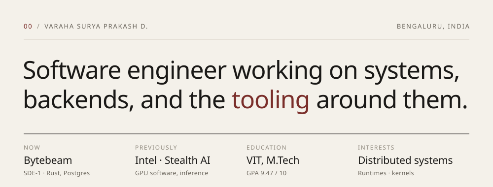
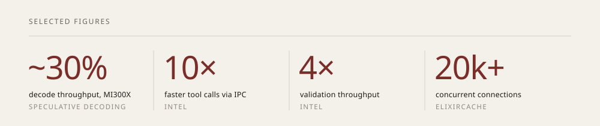

<a href="https://prakash-swe-portfolio.vercel.app">
  <picture>
    <source media="(prefers-color-scheme: dark)" srcset="assets/banner-dark.svg">
    
  </picture>
</a>

I'm a software engineer at **Bytebeam**, building a product backend from scratch in Rust and PostgreSQL. Before that I optimised LLM inference on AMD MI300X GPUs at a stealth AI startup and built driver-validation automation at **Intel**. Outside work I build the things I want to understand properly: Raft in Elixir, a preemptive kernel in Rust, and a model of Go's garbage collector.

[Portfolio](https://prakash-swe-portfolio.vercel.app) &nbsp;·&nbsp; [Résumé](https://prakash-swe-portfolio.vercel.app/resume.pdf) &nbsp;·&nbsp; [LinkedIn](https://www.linkedin.com/in/soulglory/) &nbsp;·&nbsp; [Writing](https://hashnode.com/@varahasuryaprakash) &nbsp;·&nbsp; [Email](mailto:prakashcollymore@gmail.com)

<picture>
  <source media="(prefers-color-scheme: dark)" srcset="assets/figures-dark.svg">
  
</picture>

### Work

| Period | Role | |
| :-- | :-- | :-- |
| Aug 2026 — now | **Software Engineer (SDE-1)**, Bytebeam | Telematics product backend in Rust and PostgreSQL: ingestion and storage for vehicle telemetry. |
| Jun — Jul 2026 | **GPU Performance Engineering Intern**, stealth AI startup | Eagle3 speculative decoding for `gpt-oss-120b` on AMD MI300X: 196 → 255 tok/s on one GPU. |
| Jul 2025 — May 2026 | **GPU Software Development Intern**, Intel | Driver-validation automation: 4× throughput, 10× faster tool calls via IPC. |

### Selected projects

| Project | Domain | |
| :-- | :-- | :-- |
| [**RaftEx**](https://github.com/ProgMastermind/raft-elixir) | Distributed systems | Raft from the paper in Elixir/OTP: elections, log replication, snapshots, joint consensus. [Write-up](https://elixir-raft.hashnode.dev/i-built-raft-consensus-from-scratch-in-elixir-here-s-what-the-paper-doesn-t-tell-you) |
| [**ElixirCache**](https://github.com/ProgMastermind/ElixirCache) | Storage & networking | Redis-compatible cache with RESP and master–replica replication; held 20,000+ connections. |
| [**FerrOS**](https://github.com/ProgMastermind/Rust_OS) | Operating systems | Preemptive x86_64 kernel in Rust that boots to a shell; 23 QEMU tests. [Case study](https://prakash-swe-portfolio.vercel.app/projects/rust-os) |
| [**Work-Stealing Scheduler**](https://github.com/ProgMastermind/work-stealing) | Concurrency | Go-runtime-style scheduler with per-processor queues and randomized stealing. |
| [**TriMark**](https://github.com/ProgMastermind/Garbage-Collector) | Language runtimes | Go's concurrent tri-colour mark-and-sweep collector, built in 10 phases. |

### Toolbox

**Languages** &nbsp; Go · Rust · Elixir · Python · Java · JavaScript 
**Systems** &nbsp; OTP · Linux · Docker · Kubernetes · PostgreSQL · Redis 
**GPU & inference** &nbsp; Triton · AMD ROCm · speculative decoding · LangChain · RAG

Bengaluru, India &nbsp;·&nbsp; Integrated M.Tech, VIT
